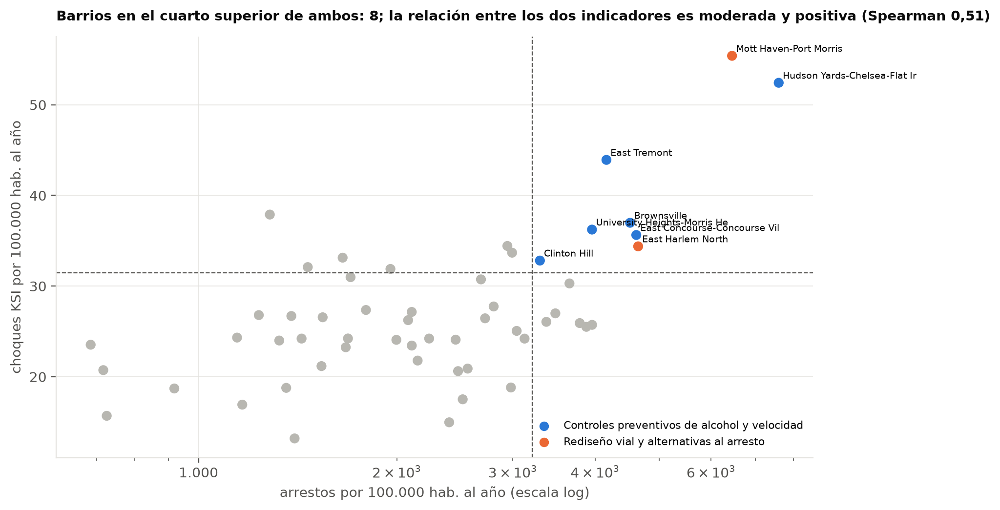

# Noches peligrosas: choques graves y control vial en Nueva York con Apache Spark

Proyecto del curso Procesamiento de Alto Volumen de Datos de la Pontificia Universidad Javeriana,
dictado por el profesor Andrés Felipe Cuervo. Lo hicimos Mateo Jaramillo Londoño, Martín Sarmiento Galeano y Wilson Muñoz Torres.

En el caso trabajamos como equipo consultor del estado de Nueva York para armar un plan de
acción basado en datos que ayude a bajar dos indicadores, la cantidad de arrestos y la de
accidentes viales. Seguimos la metodología CRISP-DM y procesamos todo en un cluster de Spark que
montamos en tres máquinas virtuales de la universidad.

## La pregunta de la entrega final

¿Dónde y cuándo debería Nueva York concentrar los controles de alcohol y velocidad para reducir
las muertes y lesiones graves en sus vías durante la noche?

Para responderla miramos si la noche es más grave que el día y cuánto pesan el alcohol, las drogas
y la velocidad. Después comparamos dónde están los arrestos por embriaguez y dónde está el riesgo,
que es lo que llamamos brecha de control, y probamos si un modelo con la información que se tiene
antes de cada noche puede decir dónde poner el próximo control. Como el caso pide bajar los dos
indicadores, también buscamos dónde se pueden usar alternativas al arresto.

Los arrestos miden la actividad de la policía, por eso no los leemos como una medida de la
criminalidad. Con los choques hay otro cuidado: desde abril de 2020 la NYPD no exige reportar los
que solo tienen daños materiales. Los totales de antes y después de ese año no se pueden comparar,
y por eso la gravedad se calcula sobre los choques con lesionados.

## Entregas

| Entrega | Contenido | Dónde |
|---|---|---|
| Primera (entendimiento del negocio y de los datos) | Documento en PDF y notebooks 00 a 06 ejecutados en el cluster | [`entregas/primera_entrega/`](entregas/primera_entrega/) |
| Final, 23-nov-2026 (preparación, respuestas, modelos y recomendaciones) | Documento en PDF y notebooks 07 a 11 ejecutados en el cluster | [`entregas/entrega_final/`](entregas/entrega_final/) |

## Preguntas de negocio

En la entrega final reformulamos las ocho preguntas de la primera entrega al volver a la fase de
entendimiento del negocio. Se responden en `10_respuestas`, donde está también de cuál pregunta
original viene cada una. La novena la responde el modelo de `11_modelos`.

| N.º | Pregunta |
|---|---|
| P1 | ¿Cómo cambiaron entre 2019 y 2025 los arrestos totales y los de conducir bajo efectos del alcohol o las drogas en cada distrito? |
| P2 | ¿Qué parte de los arrestos es por delitos menores, cuáles son y dónde hay más margen para usar alternativas al arresto? |
| P3 | ¿Qué parte de las muertes y lesiones serias en las vías ocurre de noche y en qué horas y días se concentra? |
| P4 | ¿Qué causas y qué usuarios de la vía están detrás de los choques nocturnos con muertos o lesionados serios? |
| P5 | ¿Qué barrios tienen el mayor riesgo nocturno y se mantiene ese orden de un año a otro? |
| P6 | ¿Están los arrestos por embriaguez al volante en los barrios con mayor riesgo nocturno? |
| P7 | ¿Cómo cambia el riesgo nocturno con la lluvia, la temperatura, los festivos y los fines de semana? |
| P8 | ¿Qué barrios combinan muchos arrestos y muchos choques graves, y qué intervención le conviene a cada uno? |
| P9 | ¿Puede un modelo anticipar las celdas de mayor riesgo mejor que repetir lo del año anterior? |

## Fuentes de datos

| Conjunto | Fuente | Para qué |
|---|---|---|
| Arrestos históricos y del año en curso del NYPD | NYC Open Data [`8h9b-rp9u`](https://data.cityofnewyork.us/d/8h9b-rp9u), [`uip8-fykc`](https://data.cityofnewyork.us/d/uip8-fykc) | P1, P2, P6 y P8. El control vial se identifica por el artículo 1192 de la ley de tránsito |
| Choques, vehículos y personas | NYC Open Data [`h9gi-nx95`](https://data.cityofnewyork.us/d/h9gi-nx95), [`bm4k-52h4`](https://data.cityofnewyork.us/d/bm4k-52h4), [`f55k-p6yu`](https://data.cityofnewyork.us/d/f55k-p6yu) | Eventos, causas, vehículos y gravedad por persona (KSI) |
| Población 2020 por sector censal | Censo de EE. UU., [PL 94-171](https://www.census.gov/programs-surveys/decennial-census/about/rdo/summary-files.html), archivo geográfico | Denominador por barrio |
| Clima | [OpenWeather](https://openweathermap.org/api) (clima actual y pronóstico de 5 días) y [Open-Meteo](https://open-meteo.com/) (histórico por hora 2019-2026, reanálisis) | Lluvia, nieve y temperatura de cada noche |
| Límites de los 55 barrios (PUMA 2010) | NYC Open Data [`k2r4-n9ax`](https://data.cityofnewyork.us/d/k2r4-n9ax) | Unidad espacial |
| Pobreza 2018 y SAT 2012 | NYC Open Data [`cts7-vksw`](https://data.cityofnewyork.us/d/cts7-vksw), [`f9bf-2cp4`](https://data.cityofnewyork.us/d/f9bf-2cp4) | Pobreza para P2. El SAT es contexto de la primera entrega |
| Población por condado 2018 (scraping) | [NYS Department of Health](https://www.health.ny.gov/statistics/vital_statistics/2018/table02.htm) | Bono de la primera entrega |

Las citas y la bibliografía del documento las hicimos con Zotero en APA 7. Las referencias están en
[`fuentes/referencias_entrega_final.bib`](fuentes/referencias_entrega_final.bib).

## Resultados principales

Los porcentajes y las tasas son de 2021 a 2025, salvo donde se indica otra cosa.

- Entre 2019 y 2025 los arrestos subieron 30,0 % y los de embriaguez al volante bajaron 36,2 %. El
  55,6 % de los arrestos de ese periodo es por delitos menores.
- De noche (21:00 a 05:59) ocurre el 25,8 % de los choques y el 44,9 % de las muertes. Desde 2021, un
  choque con lesionados tiene 1,39 veces la probabilidad del día de dejar un muerto o un lesionado serio.
- Las causas más graves de la noche son exceso de velocidad o agresividad (14,5 de cada 100 choques
  con lesionados son graves), error de peatón o ciclista (13,2) y alcohol o drogas (12,6).
- La relación entre los arrestos por embriaguez y el riesgo nocturno de los barrios es muy débil
  (Spearman 0,06).
- Ocho barrios están en la cuarta parte más alta de arrestos y de choques graves. En seis proponemos
  controles preventivos y en dos rediseño vial con alternativas al arresto.
- En la prueba de enero a mayo de 2026, controlar el 10 % de barrios y franjas que marca el Random
  Forest cubre el 19,6 % de los casos, frente al 18,1 % de repetir lo del año anterior. Es una ventaja
  pequeña (3,5 de 235 casos) que puede deberse al azar. Con el 5 % gana la línea base.
- K-Means separa los 55 barrios en tres perfiles, con silueta 0,33 y estabilidad entre semillas 0,53,
  por lo que se leen como orientativos.



## Cluster

Spark 4.1.3 en modo standalone sobre tres VMs con Rocky Linux 9 (4 cores y 15,7 GB cada una),
con HDFS 3.5.0 para que los tres workers lean y escriban los mismos datos. En total son 8
executors, 8 cores y 20 GB de memoria para ejecutar. Los datos pasan por cuatro capas en HDFS:
cruda (CSV y JSON), bronce (Parquet como texto), plata (tipado y limpio) y oro (agregados). Los
modelos se entrenan con MLlib sobre la capa oro.

El diseño, los recursos de cada máquina, los puertos y el registro de la instalación están en
[`docs/arquitectura.md`](docs/arquitectura.md).

## Estructura

```
proyecto-nyc-bigdata/
├── docs/          arquitectura del cluster
├── entregas/      documentos entregados y notebooks ejecutados en el cluster
├── figuras/       gráficas y tablas que generan los notebooks
├── fuentes/       página guardada para el scraping, manifiesto de descarga y referencias
├── herramientas/  conversión y ejecución de los notebooks
├── infra/         scripts para montar el cluster (cluster.env tiene toda la configuración)
├── notebooks/     notebooks y módulos comunes (config, codigos, estilo, geo, decisiones, noche)
├── scripts/       descarga de datos (incluido el clima) y ejecución de los notebooks
└── tests/         pruebas de las funciones que no necesitan Spark
```

| Notebook | Qué hace |
|---|---|
| `00` a `06` | Primera entrega: cluster, ingesta, calidad, limpieza, descripción, exploración y scraping |
| `07_fuentes_nuevas` | Choques, vehículos y personas (republicados el 28-oct-2026), población 2020, clima y calendario |
| `08_entendimiento_noche` | Quiebre de reporte de 2020, auditoría de la gravedad y de los arrestos, compuerta G1 |
| `09_capa_oro` | Choques y personas enriquecidos, panel barrio × noche × franja e índice de brecha |
| `10_respuestas` | Respuestas a P1-P8 |
| `11_modelos` | Gradient-Boosted Trees, Random Forest, regresión logística, red neuronal y K-Means |

La definición de noche y de gravedad, el periodo del modelo y las demás decisiones de la entrega
final están en [`notebooks/decisiones.py`](notebooks/decisiones.py).

## Cómo reproducirlo

1. Clonar el repositorio en todas las VMs y montar el cluster según [`docs/arquitectura.md`](docs/arquitectura.md).
2. Copiar `env_ejemplo.txt` como `.env` y poner la clave de OpenWeather (sirve el plan gratuito: clima actual y pronóstico).
3. Primera entrega: `scripts/descargar_datos.sh` y notebooks 00 a 06 con `scripts/ejecutar_notebooks.sh`.
4. Entrega final: `scripts/ejecutar_entrega_final.sh` con los pasos `verificar`, `pruebas`, `descargar`,
   `notebooks` y `empaquetar`, o `todo` para hacerlo de corrido. `repetir` vuelve a correr 07 a 11 con
   lo ya descargado. Todo queda en carpetas `entrega_final` de HDFS, sin tocar la primera entrega.
   Como NYC republicó los choques en octubre de 2026, no hay que volver a correr `01_ingesta` sobre
   un cluster que ya tenga la primera entrega: esos CSV no se pueden descargar otra vez.
5. Opcional, en cualquier computador: `python tests/probar_noche.py` y `python tests/probar_extraer_clima.py`.
